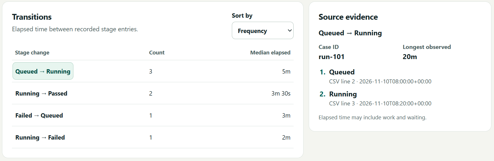

# Workflow reconstruction

Use a CSV export to see where work spent time between recorded stages and which cases returned to an earlier stage. Each transition shows its frequency and median elapsed time. Select a transition to see the original CSV lines for its longest observed example.



## Use the local browser app

Run this from the project folder with Python 3.11 or newer. No packages are needed.

```powershell
python serve.py
```

Open the printed address, usually `http://127.0.0.1:8765`, and select **Open example**. The **Queued → Running** row shows three transitions and a median of five minutes. Select it to see the longest instance (20 minutes) and the two CSV lines behind it.

To use your own data, choose a comma-separated UTF-8 CSV up to 64 MiB and map its case ID, stage and timestamp. The server binds to localhost and processes uploads in memory. Stop it with Ctrl+C. If the default port is in use, run `python serve.py --port 8766`.

## Run an example

Inspect the synthetic CI run from the command line and run the tests.

```powershell
python reconstruct.py examples/ci.csv --case-column run_id --stage-column result --time-column recorded_at --inspect run-101
python -B -m unittest discover -v
```

## Real incident management

The UCI Machine Learning Repository publishes an anonymized ServiceNow export with 141,712 records for 24,918 incidents. The analysis uses the incident ID, state, update timestamp and update counter. [Amaral, Fantinato and Peres, Incident management process enriched event log](https://doi.org/10.24432/C57S4H) · [CC BY 4.0](https://creativecommons.org/licenses/by/4.0/)

Download the [UCI archive](https://archive.ics.uci.edu/static/public/498/incident+management+process+enriched+event+log.zip) and extract it into a local folder. Replace the input path as needed.

In the browser, map `number`, `incident_state` and `sys_updated_at`. Under **Timestamp and data options**, choose `sys_mod_count` as the sequence, enter `%d/%m/%Y %H:%M` as the timestamp format, and enter `-100` as the unknown stage value.

```powershell
python reconstruct.py incident_event_log.csv --case-column number --stage-column incident_state --time-column sys_updated_at --time-format "%d/%m/%Y %H:%M" --order-column sys_mod_count --unknown-stage=-100 --inspect INC0000246
```

The run analyzed 24,916 incidents and excluded two with state `-100`. Of those analyzed, 1,024 returned to an earlier state. The 4,657 direct **Awaiting User Info → Resolved** transitions had a median of 4 days, 1 hour, 38 minutes. A separate SQLite query reproduced the count and median. The interval includes any work and waiting between the two recorded updates.

For incident `INC0000246`, the log shows 48 hours and 15 minutes between **Awaiting User Info** and the return to **Active**. It records resolution six minutes later. See CSV records 643, 645 and 647.

The tested archive SHA-256 was `6294e29a311647306bfdfc85783f7df66517c197b9cd49aa5ee36ba9c525d1d6`.

## Real software review

The same analyzer processed 23 selected milestones from six public CPython pull requests, #1 through #6. In [CPython PR #2](https://github.com/python/cpython/pull/2), 1 hour, 49 minutes, 6 seconds elapsed from opening to the first formal review. The first recorded request for changes was followed by approval 8 minutes, 22 seconds later. Those are recorded milestones. They do not measure editing time. The six historical PRs test portability and are too small to estimate typical review latency.

<details>
<summary>Reproduce the CPython example in PowerShell</summary>

The sample had fewer than 100 reviews per PR. [GitHub pull requests API](https://docs.github.com/en/rest/pulls/pulls) · [Reviews API](https://docs.github.com/en/rest/pulls/reviews)

```powershell
$base = 'https://api.github.com/repos/python/cpython'
$headers = @{ Accept = 'application/vnd.github+json'; 'User-Agent' = 'workflow-reconstruction-proof' }
$pulls = Invoke-RestMethod -Uri "$base/pulls?state=closed&per_page=6&sort=created&direction=asc" -Headers $headers
$sample = foreach ($pull in $pulls) {
    $reviews = Invoke-RestMethod -Uri "$base/pulls/$($pull.number)/reviews?per_page=100" -Headers $headers
    [pscustomobject]@{
        number = $pull.number; url = $pull.html_url; draft = $pull.draft
        created_at = $pull.created_at; merged_at = $pull.merged_at; closed_at = $pull.closed_at
        reviews = @($reviews | Select-Object id,state,submitted_at)
    }
}
ConvertTo-Json -InputObject @($sample) -Depth 5 | Set-Content -Encoding utf8 cpython.json
python github_reviews_to_csv.py cpython.json | Set-Content -Encoding utf8 cpython.csv
python reconstruct.py cpython.csv --inspect 2
```

The converter tracks opening, the first formal review, later approvals and change requests, and merge or close. It skips current drafts and reviews posted after merge or close. Ready-for-review and reopen events are outside the sample. The output includes review links in its `source` column.

</details>

## Use a different workflow

Provide one row per observation with a stable case ID, a stage, and a timestamp. Use ISO timestamps with offsets when possible. A format without a timezone measures wall-clock time. If different stages share a timestamp, map a reliable integer sequence to order them. Otherwise the app excludes the ambiguous case.

The app builds one timeline per case and collapses consecutive observations of the same stage. It counts a return when a case leaves a stage and later reaches it again. A retry can be expected, as in the CI example. The input needs historical observations. Parallel work or linked cases need a richer event format. [OCEL 2.0](https://www.ocel-standard.org/)

## Contribute a workflow

Describe who uses it, what decision they need to make, and which records can answer it. Include a shareable anonymized or synthetic CSV, the column mapping, and one expected timeline and interval that a reviewer can reproduce. State what the export omits and attribute any external data. A new example can use the existing CSV input. Add a converter when the source cannot map directly. Keep private tickets, credentials, and customer data out of submissions.

## Existing tools

[DORA's value stream mapping guide](https://dora.dev/guides/value-stream-management/) describes measuring waits and handoffs in software delivery. [PM4Py](https://github.com/process-intelligence-solutions/pm4py) provides event-log process maps and performance analysis. This app focuses on tracing elapsed time from an existing CSV export to the original source lines.

## License

[MIT](LICENSE). Copyright 2026 Wadee Kharbat.
